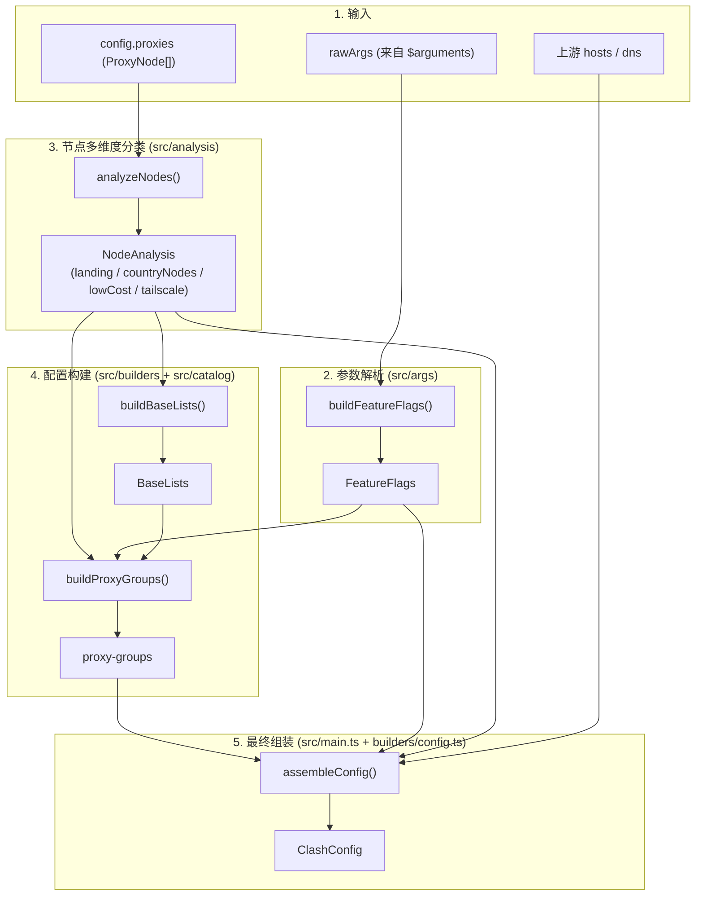

# override-rules 架构文档

本项目是一个 Mihomo/Clash 订阅覆写脚本。它拦截上游订阅配置中的代理节点，按落地/非落地、国家和地区进行多维度分类，并按照预设的规则与策略组将其重组为优化后的 Clash 配置——包含代理组、路由规则、DNS 及 TUN 支持。

源码采用「声明式数据 / 纯构建逻辑 / 组装入口」三层结构：`catalog/` 存放可独立修改的数据，`builders/` 存放不持有状态的纯函数，`main.ts` 只做流程编排。

---

## 数据流概览

整个覆写脚本的核心流程分为五个阶段：**输入** → **参数解析** → **节点分类** → **配置构建** → **最终组装**。



### 各阶段职责

| 阶段 | 核心模块 | 职责 |
|------|----------|------|
| 输入 | — | 上游订阅传入的代理节点列表 (`config.proxies`)、可继承的 `hosts`/DNS 字段与用户提供的 URL 覆写参数 (`$arguments`) |
| 参数解析 | `src/args/` | 将原始字符串参数转换为类型安全的 `FeatureFlags` 对象；默认值集中在 `schema.ts` |
| 节点分类 | `src/analysis/` | 将节点按落地/非落地、所属国家/地区、低价节点和 Tailscale 类型分类；按阈值提取活跃国家名称 |
| 配置构建 | `src/builders/` + `src/catalog/` | 先生成基础代理选择列表 (`BaseLists`)，再按声明式目录生成服务组、条件组、国家/地区组和 Tailscale 组 |
| 最终组装 | `src/main.ts` + `src/builders/config.ts` | 将原始节点、代理组、规则、Rule Provider、DNS、TUN、Geo 数据源及必要的上游字段拼装为最终 `ClashConfig` |

---

## 文件职责

| 文件 | 职责 | 关键导出 |
|------|------|----------|
| `src/main.ts` | 覆写脚本入口（banner、`globalThis.main` 契约、流程编排） | `main()` |
| `src/types/args.ts` | 参数与功能开关类型 | `ScriptArgs`, `FeatureFlags`, `GroupType` |
| `src/types/proxy.ts` | 代理节点、代理组、分类结果类型 | `ProxyNode`, `ProxyGroup`, `NodeAnalysis`, `GroupBuildContext` 等 |
| `src/types/clash.ts` | Clash 配置结构类型 | `ClashConfig`, `DnsConfig`, `TunConfig`, `SnifferConfig`, `RuleProvider` |
| `src/args/schema.ts` | URL 参数默认值的唯一来源 | `ARG_DEFAULTS` |
| `src/args/parse.ts` | URL 参数解析与默认值回填 | `buildFeatureFlags()` |
| `src/catalog/endpoints.ts` | CDN、自有仓库与测速端点 | `CDN_URL`, `PROJECT_URL`, `SPEEDTEST_URL` |
| `src/catalog/dns.ts` | DNS 默认服务器与 fake-ip 过滤域名 | `DEFAULT_NAMESERVERS`, `DEFAULT_FALLBACK_DNS`, `FAKE_IP_FILTER` |
| `src/catalog/icons.ts` | 代理组图标集中定义 | `ICONS` |
| `src/catalog/group-names.ts` | 代理组名称与命名辅助 | `PROXY_GROUPS`, `NODE_SUFFIX`, `countryGroupName()` |
| `src/catalog/countries.ts` | 国家/地区元数据；派生匹配正则 | `countriesMeta`, `countryRegexMap`, `countryExcludeRegexMap` |
| `src/catalog/low-cost.ts` | 低倍率节点匹配器 | `LOW_COST_NODE_MATCHER` |
| `src/catalog/service-groups.ts` | 服务代理组的声明式目录 | `serviceGroups` |
| `src/catalog/rule-sets.ts` | Rule Provider 注册表（强类型键） | `ruleSets`, `RuleSetKey`, `ruleSet()` |
| `src/analysis/classify.ts` | 节点多维度分类 | `analyzeNodes()` |
| `src/analysis/active-countries.ts` | 地区阈值过滤与权重排序 | `getActiveCountryNames()` |
| `src/analysis/prefer-nodes.ts` | `prefer` 优先节点正则匹配（Fork 扩展） | `collectPreferNodes()` |
| `src/domain/proxy-group.ts` | 代理组构造工厂（字段顺序与空候选兜底集中管理） | `buildGroupByType()`, `selectGroup()`, `urlTestGroup()`, `fallbackGroup()` |
| `src/builders/selectors.ts` | 各策略组的基础候选列表 | `buildBaseLists()` |
| `src/builders/proxy-groups.ts` | 代理组组装（前置/服务/尾部/地区） | `buildProxyGroups()` |
| `src/builders/rules.ts` | 路由规则构建 | `buildRules()` |
| `src/builders/rule-filter.ts` | `include`/`exclude` 规则裁剪与代理组/规则集联动剔除（Fork 扩展） | `shouldKeepRule()`, `filterProxyGroupsByRules()`, `filterRuleSetsByRules()` |
| `src/builders/rule-set` 引用 | 规则集名称受 `RuleSetKey` 约束，改名可编译期报错 | — |
| `src/builders/dns.ts` | DNS 核心配置生成与上游字段合并 | `buildDns()` |
| `src/builders/sniffer.ts` | 域名嗅探配置 | `snifferConfig` |
| `src/builders/tun.ts` | TUN 模式配置 | `buildTunConfig()` |
| `src/builders/full-config.ts` | `full=true` 时追加的完整内核参数 | `buildFullConfig()` |
| `src/builders/geox.ts` | GeoIP/GeoSite/MMDB/ASN 数据源地址 | `geoxUrl` |
| `src/builders/config.ts` | 最终配置组装（含 GLOBAL 组追加） | `assembleConfig()` |
| `src/utils/primitives.ts` | 通用工具函数 | `buildList()`, `parseBool()`, `parseNumber()`, `isNotNull()` |
| `src/utils/regex.ts` | 正则匹配工具 | `createCaseInsensitiveNodeMatcher()` |
| `scripts/yaml_generator/generator.ts` | 静态 YAML 覆写文件生成器 | 穷举参数组合，生成 `yamls/` 目录下的 192 个 YAML 配置文件；支持 `LIMIT_COMBOS` 限制生成数量 |
| `src/catalog/honk-groups.ts` | honk 输出专用的组名/策略/地区映射 | `HONK_GROUP_NAMES`, `HONK_POLICIES`, `toHonkName()`, `requireHonkName()`, `honkCountryName()` |
| `src/types/honk.ts` | honk 构建层需要的类型 | `HonkScriptArgs`, `HonkRuntimeOptions`, `HonkBuildContext`, `InlineRuleSetMap`, `HonkGroupSpec` |
| `src/args/honk-schema.ts` | honk 独有参数的默认值 | `HONK_ARG_DEFAULTS` |
| `src/args/honk-parse.ts` | honk 独有参数的解析 | `buildHonkRuntimeOptions()` |
| `src/builders/honk/` | honk `config.dae` 文本构建层 | `filter.ts` 生成 filter 表达式；`groups/rules/dns/assets.ts` 分段渲染；`render.ts` 拼装 banner + `include { system.dae }` + 五段策略 |
| `src/main-honk.ts` | honk 覆写的运行时入口（`convert-honk.js` / `convert-honk.min.js`） | `globalThis.main = (config) => string`；同时导出 `runHonkEntry()` 供测试直接调用 |
| `src/generated/honk-rulesets.ts` | 自维护 `ruleset/*.list` 的编译期内联产物 | `INLINED_HONK_RULESETS`；由 `scripts/generate-honk-rulesets.mjs` 写入，已提交到 git |
| `scripts/generate-honk-rulesets.mjs` | 将 `ruleset/*.list` 转写为 `src/generated/honk-rulesets.ts` | `npm run generate:honk-rulesets`；`npm run build` 会自动先跑一次 |
| `tests/` | 轻量单元测试（`node --import tsx --test`） | 覆盖参数解析、节点分类、代理组构造、规则/DNS/TUN、最终组装 |

---

## 设计决策

### 模块化与「改一处不影响别处」

- **声明式数据与逻辑分离**：新增/调整一个服务代理组，只需在 `catalog/service-groups.ts` 增加一条记录，无需改动组装逻辑；调整图标只需改 `catalog/icons.ts`；调整参数默认值只需改 `args/schema.ts`。
- **规则集强类型**：`rules.ts` 中所有 `RULE-SET` 引用都通过 `ruleSet(key, target)` 生成，`key` 受 `RuleSetKey` 约束，规则集改名或拼写错误会在编译期报错。
- **字段顺序集中管理**：代理组的键插入顺序决定 YAML 输出顺序，因此各类代理组的字段顺序统一由 `domain/proxy-group.ts` 的工厂函数保证，测试中亦有断言锁定。
- **空代理组兜底集中管理**：`selectors.ts` 只负责生成候选列表，允许出现空列表；`domain/proxy-group.ts` 的 `normalizeNodeSource()`（以及经其处理的 `buildGroupByType()`）在既无显式 `proxies` 又未启用 `include-all` 时统一补入 `DIRECT`，确保最终不会输出空组。
- **类型按域拆分**：`types/args.ts`、`types/proxy.ts`、`types/clash.ts` 各自独立，避免单文件成为全局改动的耦合点。

### 落地/非落地自动检测

`dialer-proxy` 在 Clash 链式代理中表示当前节点通过指定代理拨号。脚本据此自动区分：

- 包含 `dialer-proxy: "前置代理"` 字段的节点 → **落地节点**（目标/出口节点），归入「落地节点」组
- 其余所有节点 → **非落地节点**（中继/普通节点），归入国家地区分组和「前置代理」组

变量 `landing` 为 `true` 当且仅当存在落地节点（`landingNodes.length > 0`）。只要出现落地节点，就会生成「落地节点」与「前置代理」组；全落地时地区分类为空，「前置代理」组仅保留 `DIRECT`。地区与低倍率分类始终只扫描非落地节点。

### 节点分类

节点在进入配置构建阶段前，由 `analyzeNodes()` 经过四个独立维度的分类，产出一个 `NodeAnalysis`：

1. **落地/非落地** — 决定节点归属的代理组类型。当 `landing = true` 时，后续的国家和低价节点分类只扫描非落地节点（即落地节点不参与按国家分发）。
2. **国家/地区** — 通过正则匹配节点名称中的地理位置关键字，将节点归入对应的国家/地区分组。匹配规则定义在 `countriesMeta` 中。
3. **低价节点** — 匹配特定正则 (`LOW_COST_NODE_MATCHER`) 的节点归入低价策略组，供用户按需选用。
4. **Tailscale** — `type: "tailscale"` 的节点单独归入 Tailscale 代理组；只有检测到此类节点时才生成该组及对应的规则。该组默认 `hidden: true`，且 Tailscale 节点不参与国家/低价分类与常规候选列表。

这些分类维度相互独立，构建阶段通过组合它们来生成完整的代理组树。

分类结果还会派生 `regionLayout`：通过 `threshold` 的地区数 ≥ 2 时为 `grouped`，为每个地区生成 `${地区}节点` 组，并保留「手动选择」组；不足 2 个时为 `flattened`，不生成任何地区组，`选择代理`、`自动选择`、`故障转移` 直接引用非落地节点（不含 Tailscale），同时不再生成与 `选择代理` 高度重合的「手动选择」组。服务组同样按 `regionLayout.groupedCountries` 判断目标地区组是否存在，避免引用已展平的地区组；展平模式下服务组的 `defaultProxies` / `defaultProxiesDirect` 也不再引用 `选择代理`，而是直接携带同一份展平节点来源。若存在「低倍率节点」组，「静态资源」组会将其置于候选首位，其余候选保持正常顺序。

### Tailscale 集成

当订阅中存在 `type: "tailscale"` 的节点时，脚本会：

- 创建只包含 Tailscale 节点的「Tailscale」代理组（默认 `hidden: true`）；
- 将 Tailscale 节点从「手动选择」、展平模式下的 `选择代理` / `自动选择` / `故障转移` / 服务组、地区组、低倍率组及「前置代理」等常规候选中排除（`regex=true` 时通过 `exclude-filter` 排除）；
- 为 `100.64.0.0/10`、`fd7a:115c:a1e0::/48` 和 `ts.net` 添加定向分流规则；
- Tailscale 存在时不排除对应地址段，使其能够交由 Tailscale 代理组处理；不存在时则排除这些地址段，避免无效的路由进入 TUN。

没有 Tailscale 节点时，上述代理组和分流规则不会生成；TUN 仍输出统一的基础配置，并额外排除 Tailscale 地址段与局域网地址段。

### PT 站点分流

PT 不作为独立的布尔开关，而是与 `EHentai`/`Weibo` 完全同构的一条普通规则：`buildRules()` 规则列表中的 `RULE-SET,PT,PT站点` 默认存在，因此：

- 「PT站点」`select` 代理组在 `catalog/service-groups.ts` 中与其余服务组一同声明，候选列表使用 `defaultProxiesDirect`（`DIRECT` 优先，允许手动切代理）；
- `exclude=PT` 时，规则、`rule-providers` 与代理组均由已有的 include/exclude 联动过滤逻辑一并剔除；
- `include` 白名单模式下，`PT` 与其他规则标识一样需显式列出才会保留。

域名集合为本仓库自维的 `ruleset/PT.list`（对齐 `EHentai`/`Weibo` 等自有规则集的托管方式），便于 Fork 者直接增删站点。PT 只覆盖域名层面的站点分流：BT/PT 下载数据面向公网 peer，端口由对端随机分配，无法靠域名/端口规则可靠识别，因此不注入内网或端口的强制直连规则，也不修改 TUN 路由排除配置。

### 规则过滤与优先选路（Fork 扩展）

以下两个能力属于本 Fork 的扩展，实现集中在 `src/builders/rule-filter.ts` 与 `src/analysis/prefer-nodes.ts`，对上游模块只保持最小接入点，便于后续同步上游。

**`include` / `exclude` 联动过滤**：过滤发生在最终组装阶段（`builders/config.ts`），链路为「规则 → 代理组 → 规则集」：

1. `buildRules()` 按标识（规则集名、GEOSITE/GEOIP 键、`DOMAIN-SUFFIX` 域名）裁剪规则，基础规则（私有地址、CN 直连、`MATCH`）始终保留；QUIC 拦截与 Tailscale 定向分流规则不参与裁剪。
2. 由裁剪后的规则反推被引用的代理组，剔除未使用的服务组；基础设施组（`选择代理`/`手动选择`/`自动选择`/`故障转移`/`Final`/`低倍率节点`/`前置代理`/`落地节点`/`GLOBAL`/`优先选择`/`Tailscale`）与地区组始终保留，否则选路体系会失去基石。
3. 清理保留组候选列表里指向已删除组的悬空引用；列表被清空且未启用 `include-all` 时补入 `DIRECT`，与 `domain/proxy-group.ts` 的空组保护一致。
4. `rule-providers` 只保留仍被 `RULE-SET` 引用的条目，避免客户端下载无用规则集。

`GLOBAL` 组在裁剪之后追加，因此其候选也不会包含被剔除的组。两个参数都不传时过滤完全不启用，输出与上游行为一致。

**`prefer` 优先选路**：`collectPreferNodes()` 在节点分类阶段匹配订阅节点名称（支持正则、大小写不敏感，并捕获编译/匹配异常），命中集合不含 Tailscale 节点（沿用上游「Tailscale 不进入常规候选」的约束），命中的节点组成「优先选择」`fallback` 组（候选为「命中节点 + `自动选择`」）并置于代理组列表首位，同时排在 `选择代理` 候选首位；未传参或无命中节点时不生成该组。`include` 解析结果为空集（如 `include=,`）时归为「未启用」，不会输出几乎没有分流规则的配置。

### 数据流

- **分类结果即唯一数据源**：`analyzeNodes()` 一次性返回 `NodeAnalysis`，后续构建阶段不再回读 `config.proxies`，保证判定依据可追溯。
- **`NODE_SUFFIX` 仅在展示层添加**：`"节点"` 后缀（如「香港」→「香港节点」）只在 `buildBaseLists()` 与 `buildProxyGroups()` 中通过 `countryGroupName()` 拼接，分类层完全不涉及此概念。
- **数据优于标志**：接收节点信息的参数统一使用具体数据（如 `landingNodes: ProxyNode[]`、`countryNodes: Record<string, ProxyNode[]>`）而非布尔值；布尔标志（如 `landing`）由数据推导得出。

### args 的默认值

所有 URL 参数都有明确的默认值，集中在 `src/args/schema.ts` 的 `ARG_DEFAULTS`，由 `buildFeatureFlags()` 解析并回填。当前默认值包括：

- `grouptype=1`（`url-test`）；若未指定 `grouptype`，仍兼容旧的 `loadbalance` 参数；
- `fakeip=true`；
- `threshold=2`，少于两个节点的地区不会生成地区组；过滤后不足 2 个地区时整体展平；
- `ipv6`、`full`、`keepalive`、`quic`、`regex`、`tun` 默认关闭。

本 Fork 新增的 `include`、`exclude`、`prefer` 没有默认值：不传参时分别表示「不过滤规则」与「不启用优先选路」。`include` 与 `exclude` 同时传入时 `include` 优先。

布尔参数接受 `true`/`false` 和 `1`/`0` 形式。

### 上游配置继承

脚本不会无条件覆盖上游配置的全部字段：

- 始终保留上游 `hosts`；
- 在生成 DNS 配置后，合并上游的 `nameserver-policy`、`proxy-server-nameserver-policy`、`proxy-server-nameserver` 和 `fake-ip-filter`（列表字段会去重）；
- 脚本生成的 DNS 核心设置（如增强模式、IPv6 开关和默认 DNS 列表）保持优先级。

这样既能维持脚本的统一 DNS 行为，也能保留订阅提供方针对特定域名的策略。

### YAML Generator 的参数

静态 YAML 配置文件通过 `scripts/yaml_generator/generator.ts` 穷举参数组合生成：

| 参数 | 可选值 | 数量 |
|------|--------|------|
| `ipv6` | true / false | 2 |
| `full` | true / false | 2 |
| `keepalive` | true / false | 2 |
| `fakeip` | true / false | 2 |
| `quic` | true / false | 2 |
| `tun` | true / false | 2 |
| `grouptype` | select / url-test / load-balance | 3 |

共计 2⁶ × 3 = 192 个 YAML 文件。`landing` 不在 FLAGS 中——YAML 生成器使用 `fake_proxies.json` 中的模拟节点数据自动判定。生成时固定启用 `regex: true`，因为静态配置无法预知实际订阅的节点名称。模拟数据覆盖多个地区，因此静态 YAML 产物仍走分组模式；展平分支由单元测试覆盖。

---

## 输出模式

本项目支持两种部署方式，分别适用于不同使用场景：

### JS 动态覆写（convert.js）

**主要模式。** 运行于 Substore 等订阅转换工具的脚本执行环境（如 Loon、Surge 的脚本功能）。脚本动态分析上游订阅传入的**真实代理节点列表**，根据节点名称中的地理位置关键字和属性字段（如 `dialer-proxy`）实时分类，并生成包含完整代理组、规则、DNS 及 TUN 配置的 Clash 配置。

这是推荐的使用方式，原因在于：

- 节点分类结果始终反映当前订阅的实际状态，新增或失效的节点会自动归入对应分组
- 代理组可直接枚举具体节点名称（`regex: false`），比正则过滤更精确
- 支持完整的运行时参数覆盖（通过 URL hash 传参）

### 静态 YAML 覆写（yamls/*.yaml）

**备用模式。** 通过 `scripts/yaml_generator/generator.ts` 预先生成的 YAML 配置文件，存放在 `yamls/` 目录下。这些文件使用 `scripts/yaml_generator/fake_proxies.json` 中的模拟节点数据穷举所有参数组合生成，供无法运行 JS 脚本的客户端直接引用。

YAML 模式的特点：

- 地区组使用正则过滤（`include-all` + `filter`），「手动选择」组使用 `include-all`，而非枚举具体节点名称——这是静态文件无法预知真实节点列表的必然选择
- 所有参数组合已预编译，用户只需选择对应的 YAML 文件 URL
- 不依赖脚本运行时，兼容性最广

两种模式共享同一套 `src/catalog/` 与 `src/builders/` 逻辑，区别仅在于运行时的数据来源和过滤方式。

### honk 动态覆写（convert-honk.js）

**面向 [daeuniverse/honk](https://github.com/daeuniverse/honk) 客户端的产物**（honk 是 dae 的 Rust + eBPF 重写，配置语法沿用 dae，文件后缀 `.dae`）。honk 本身不执行 JS、也不能从 URL 拉 `config.dae` 本体，但 Sub-Store 侧完全可以把 JS 返回的字符串直接当响应体吐出来。本项目的 honk 入口 `src/main-honk.ts` 与 Clash 侧的 `src/main.ts` **同构**，`main(config)` 返回 `string`，Sub-Store 会把它原样输出，honk `wget` 拉下来就是能用的 `config.dae`。

与 mihomo 分支共享：参数解析 `buildFeatureFlags` / 节点分类 `analyzeNodes` / 国家与服务目录 `catalog/countries` / `catalog/service-groups` / `catalog/rule-sets` / `catalog/low-cost`；分叉点只在构建层：mihomo 走 `builders/{config,proxy-groups,rules,dns,tun,sniffer,full-config,geox}.ts`，honk 走 `builders/honk/*`。

#### 只输出策略骨架，不输出部署层

honk 的 `config.dae` 一共八段：`global` / `subscription` / `node` / `group` / `dns` / `routing` / `assets` / `experimental`。本项目只写**策略相关的五段**（`subscription` / `group` / `dns` / `routing` / `assets`），`global` 与 `experimental` 属于部署层（网卡、数据目录、面板监听地址与口令），**交给同目录下的 `system.dae`**，本项目的 `config.dae` 顶部固定写：

```
include {
    system.dae
}
```

honk 会把 `system.dae` 里的段与本体自动合并（参见 [honk 配置指南](https://github.com/daeuniverse/honk/blob/main/doc/zh/configuration.md#使用-include-拆分配置)：后出现的标量 key 覆盖先前的，集合条目按顺序追加）。好处：

- **部署层变更不需要重跑本项目**：换网卡、改面板口令、开/关 API 都不影响策略骨架，直接改 `system.dae` + `SIGHUP`；
- **多设备共用同一份策略**：同一个 Sub-Store Override URL 可以给 OpenWrt 主路由与 x86 旁路由共同拉，各自的 `system.dae` 写自己环境的网卡与面板地址；
- **luqi-app-honk 等托管面板兼容**：OpenWrt 上 luci 面板依赖 `system.dae` 存在来写监听端口与 API 开关，本项目不写 `global/experimental` 就不会冲突。

#### 三段式参数体系

honk 入口的 `$arguments` 同时包含三类参数，互不干扰：

| 类别 | 字段 | 解析器 | 默认值 |
| --- | --- | --- | --- |
| 与 mihomo **同义** | `grouptype` / `threshold` / `ipv6` / `quic` / `adblock` / `include` / `exclude` / `prefer` | `args/parse.ts::buildFeatureFlags()` | 与 mihomo 分支一致，`args/schema.ts::ARG_DEFAULTS` |
| **honk 独有（策略）** | `subscription` / `sub-*` / `dns-*` | `args/honk-parse.ts::buildHonkRuntimeOptions()` | `args/honk-schema.ts::HONK_ARG_DEFAULTS` |
| **honk 会忽略 / 已迁到 `system.dae`** | `landing` / `fakeip` / `tun` / `sniffer` / `keepalive` / `full` / `regex`（本身无对应）；`lan-iface` / `wan-iface` / `dial-mode` / `data-dir` / `log-level` / `native-*` / `clash-*`（已迁到 `system.dae`） | 不读取 | — |

两个解析器都只取自己关心的键，多余字段自然丢弃；honk 入口把 `rawArgs` 同时传给 `buildFeatureFlags` 与 `buildHonkRuntimeOptions`，确保两侧行为一致。完整的 honk 参数列表与默认值见 [`README.md`](../README.md#honk-支持的传参)。

#### 自维护 ruleset 的内联链

honk 没有 `rule-provider`，项目自带的 `ruleset/*.list`（`PT` / `TikTok` / `EHentai` / `Weibo` / `SteamFix` / `AdditionalFilter` / `AdditionalCDNResources`）必须在**编译期**烘到 JS bundle 里，才能让运行时产物包含完整域名列表：

```
ruleset/PT.list
   │
   ▼ scripts/generate-honk-rulesets.mjs   (npm run build 会自动先跑一次)
src/generated/honk-rulesets.ts  (INLINED_HONK_RULESETS)
   │
   ▼ import
src/main-honk.ts
   │
   ▼ buildHonkDae(ctx, INLINED_HONK_RULESETS)
src/builders/honk/rules.ts  → inlineRuleSet(entries, target) → domain(full|suffix|keyword: …) -> Group
```

`src/generated/honk-rulesets.ts` 已**提交到 git**，避免克隆后必须先 `npm run build` 才能 `npm test`；修改 `.list` 文件后 `npm run artifacts` 会自动重生成。外部 rule-provider（`ADBlock` / `GFWList` 等）在产物里降级为 `geosite: category-ads-all` / `geolocation-!cn` 近似；无法近似的外部源（`SogouInput` / `StaticResources` / `CDNResources`）以 `# [honk] ...` 注释提示。

#### Clash → honk 的语义映射

| Clash 侧概念 | honk 输出侧的处理 |
| --- | --- |
| `proxy-groups` 候选列表（引用其他组） | honk 组只能靠 `filter: name(regex: '…')` 命中订阅节点；`Select` / `Auto` / `Fallback` / 服务组 都用 `!name(regex: '<utility 关键词>')` 覆盖全订阅，策略上区别仅在 `policy` |
| `url-test` / `select` / `load-balance` | 分别对应 `min_moving_avg` / `select` / `loadbalance`；另有 `fallback`、`score`（Final 使用） |
| 中文/含空格组名 | honk 只允许 `[A-Za-z0-9]`；`HONK_GROUP_NAMES` 一次性映射为 ASCII 名（`AI`、`Crypto`、`TruthSocial` 等） |
| `GEOSITE,<code>,<group>` | `domain(geosite: <code>) -> <HonkGroup>`，保留 `@cn` 与 `!cn` 修饰符 |
| `GEOIP,cn,DIRECT` | `dip(geoip: cn) && !dport(53, 853) -> direct(must)`，避免误伤 DNS/DoT |
| `RULE-SET,<key>` | 项目自维护的 `ruleset/*.list` 编译期内联为 `domain(full\|suffix\|keyword: …)`；`ADBlock` 近似为 `geosite: category-ads-all`，`GFWList` 近似为 `geosite: geolocation-!cn`；其他外部 rule-provider（`SogouInput` / `StaticResources` / `CDNResources`）以注释提示 |
| `AdBlock` / `SogouInput` 代理组 | 不建组，路由层直接落到 `block` / `direct`，与 kenzok8 / qichiyuhub 模板一致 |
| `MATCH,<group>` | `fallback: <HonkGroup>` |
| QUIC 拦截 | `l4proto(udp) && dport(443) -> block` |
| `prefer`（Fork） | 命中时生成 `Prefer` 组：`policy: fallback`，`final: Auto` |
| `include` / `exclude`（Fork） | 与 mihomo 分支共用 `shouldKeepRule()`，在翻译到 honk 之前先把 Clash 侧规则列表裁一遍；语义完全一致 |

#### 被丢弃的字段

honk 本身不包含下列概念，相关参数在运行时传不传都一样，`.dae` 产物里不产生输出：

- `landing` 与 `dialer-proxy` 链式代理（honk 无 dialer-proxy）；
- `Tailscale` 节点与 `100.64.0.0/10` 定向分流（honk 无 tailscale outbound）；
- `fake-ip` 引擎（honk 仓库 README 明确“no FakeIP engine”）、`sniffer`、`tcp-keep-alive`；
- `tun` 段（honk 是 eBPF 透明代理，开启 `nfqueue_enable` 与 `auto_config_kernel_parameter` 即可）；
- `manual`（手动选择）：`Select` 组已承担同类作用；
- `GLOBAL` 汇总组：`Final` 负责兜底。

产物 banner 里会重复写一份上述丢弃项的注释（一行提示），方便排查。

#### 与 `convert.js` / `yamls/` 的关系

| 方面 | `convert.js` / `convert.min.js` | `yamls/*.yaml` | `convert-honk.js` / `convert-honk.min.js` |
| --- | --- | --- | --- |
| 客户端 | Clash/Mihomo，支持 Sub-Store JS Override | 不支持 JS 的旧版 Clash 客户端 | honk（Linux eBPF 网关，OpenWrt / 软路由为主） |
| 入口文件 | `src/main.ts` | `scripts/yaml_generator/generator.ts` 包装 `convert.js` | `src/main-honk.ts` |
| 构建方式 | `scripts/build.mjs` 一次 esbuild | 依赖先跑 `npm run build` 产出 `convert.js`，再由 `vm.runInContext` 执行 | `scripts/build.mjs` 与 mihomo 同批次 esbuild，共享 `prebuild` 钩子写入 `src/generated/` |
| 输出形式 | Clash 配置对象 → YAML | 预先穷举的 192 份 YAML | 字符串 `config.dae`，Sub-Store 原样吐出 |
| 参数传递 | URL hash，与 `$arguments` 合并 | 不同文件对应不同参数组合 | URL hash，与 `$arguments` 合并 |
